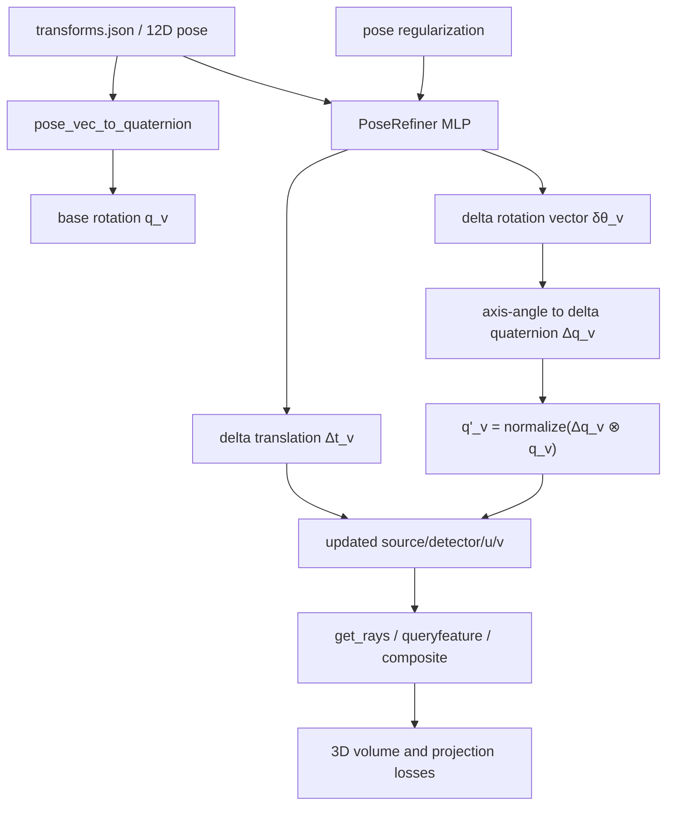
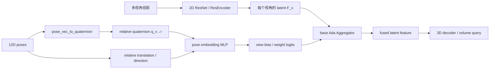
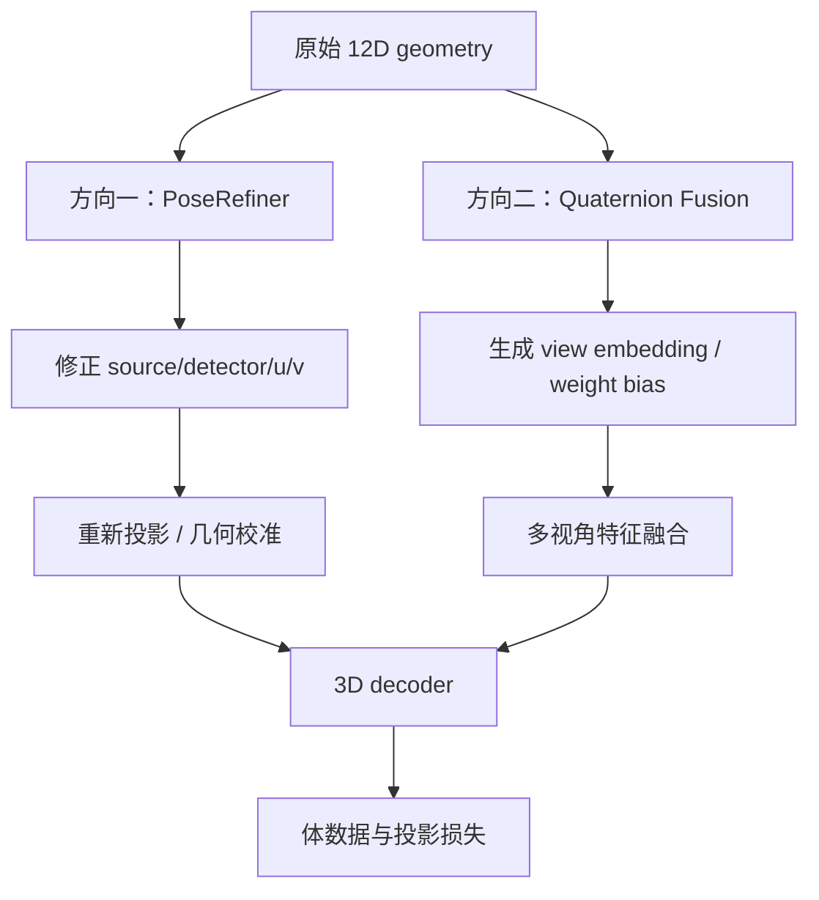

# 四元数几何的两个实现方向

本文说明两个可以嵌入当前 Geometry-Aware CBCT 模型的四元数方向：

1. 用四元数表示视角旋转，并学习每个视角的几何误差；
2. 将相对四元数作为视角融合的几何条件。

二者可以单独做消融，也可以组合成 joint 模式。当前项目已经具备方向二的
基础实现，并具备方向一的 PoseRefiner 接口；本文同时给出完整的设计依据和
推荐的网络结构。

---

## 一、方向一：四元数几何校准

### 1. 几何表示

当前每个视角的 12 维参数为：

```text
pose_v = [source, detector, u_vector, v_vector]
```

其中 `u_vector` 和 `v_vector` 是探测器平面的两个基向量。先归一化：

$$
\hat{\mathbf{u}}=\frac{\mathbf{u}}{\|\mathbf{u}\|},\qquad
\hat{\mathbf{v}}=\frac{\mathbf{v}}{\|\mathbf{v}\|}
$$

再计算探测器法向量：

$$
\hat{\mathbf{n}}=
\frac{\hat{\mathbf{u}}\times\hat{\mathbf{v}}}
{\|\hat{\mathbf{u}}\times\hat{\mathbf{v}}\|}
$$

从而构造相机坐标系旋转矩阵：

$$
R_v=[\hat{\mathbf{u}},\hat{\mathbf{v}},\hat{\mathbf{n}}]
$$

最后转换为四元数：

$$
q_v=\operatorname{Quat}(R_v)
$$

四元数只表示旋转，不能替代原始 12 维投影几何。完整表示应为：

$$
T_v=(q_v,\mathbf{t}_v)
$$

其中平移和原始 source/detector 坐标仍然保留。因此四元数不能单独表示：

- X 射线源位置；
- 探测器位置；
- SID/SAD；
- 探测器像素间距；
- half-fan 横向偏移；
- 平板探测器的横向或纵向偏移。

### 2. 嵌入位置

方向一插入在 `models/model.py` 的 active pose 路径中：



对应的数据流为：

```text
原始 pose
    ↓
PoseRefiner
    ├── δθ_v ∈ R^3
    └── Δt_v ∈ R^3
    ↓
Δq_v = axis_angle_to_quaternion(δθ_v)
    ↓
更新 source、detector、u、v
    ↓
重新计算射线和 3D 查询特征
    ↓
3D 重建损失 + 2D 投影损失 + 几何正则
```

### 3. 推荐架构：MLP，不是 CNN

方向一的输入是每个视角的 12 维几何向量，不是图像 feature map，因此推荐使用
小型 MLP，而不是 CNN：

```text
pose_v [12]
   ↓
Linear(12 → 64)
   ↓
GELU / ReLU
   ↓
Linear(64 → 64)
   ↓
GELU / ReLU
   ↓
Linear(64 → 6)
   ├── rotation vector δθ_v [3]
   └── translation Δt_v [3]
```

不建议在 PoseRefiner 中堆叠大量 3D 残差块，原因是：

- 几何输入本身只有 12 维；
- 目标是小幅刚性校准，而不是体数据特征提取；
- 大型网络容易预测不合理的大旋转或大平移；
- 几何修正需要强正则和小的输出上界。

建议对输出进行限制：

$$
\|\delta\boldsymbol{\theta}_v\|\leq \theta_{max},\qquad
\|\Delta\mathbf{t}_v\|\leq t_{max}
$$

当前实现对应 `PoseRefiner`，由 `--pose_refine_max_angle_deg` 和
`--pose_refine_max_translation` 控制上界。

### 4. 几何损失

可以使用增量旋转向量和平移的二次正则：

$$
\mathcal{L}_{pose}=
\lambda_q\|\log(\Delta q_v)\|^2+
\lambda_t\|\Delta\mathbf{t}_v\|^2
$$

也可以使用四元数距离：

$$
\mathcal{L}_{pose}=
\lambda_q(1-\langle q_v,q'_v\rangle^2)+
\lambda_t\|\Delta\mathbf{t}_v\|^2
$$

平方内积用于消除四元数 `q` 与 `-q` 表示同一个旋转的问题。

方向一适用于：

- 扫描几何校准；
- 探测器偏移修正；
- 视角角度误差修正；
- 真实 CBCT 几何与模拟几何配准；
- 降低几何误差对 2D-to-3D lift 的影响。

但它不能解决呼吸造成的非刚性形变。四元数最多处理整体刚性旋转和平移，呼吸
形变仍需要 deformation field 或动态 4D 模型。

---

## 二、方向二：相对四元数视角融合

### 1. 相对姿态表示

原始模型先通过 2D CNN 对每个投影提取特征，再由 `Ada`、`local`、`meanmlp`
或 `varmlp` 等 Aggregator 融合多视角特征。方向二不改变原始 CNN，而是在
Aggregator 旁边增加一个几何条件分支。

对于参考视角 `r`，定义：

$$
q_{v\rightarrow r}=q_r^{-1}\otimes q_v
$$

再构造几何 embedding：

$$
e_v=\operatorname{MLP}
\left[q_{v\rightarrow r},
\mathbf{t}_{v\rightarrow r},
\mathbf{d}_v\right]
$$

其中 `d_v` 可以表示源到探测器的方向或其他方向相关量。

### 2. 嵌入位置

方向二插入在 `models/model.py` 的 `_fuse_views()`：



更具体地说：

```text
投影图像 I_v
    ↓
2D CNN / ResEncoder
    ↓
视角特征 F_v

12D pose_v
    ↓
旋转矩阵 → 四元数 q_v
    ↓
相对四元数 q_ref^-1 ⊗ q_v
    ↓
Pose MLP
    ↓
view bias

F_v + view bias
    ↓
Ada / local / meanmlp / varmlp
    ↓
融合特征 F_fused
    ↓
3D decoder
```

### 3. 推荐架构：原始 CNN + 几何 MLP + Aggregator

方向二不是用 CNN 替代 Aggregator，也不是把 quaternion 直接拼接到 3D 体素中。
推荐结构是：

```text
图像分支：
I_v → ResNet18 风格 2D CNN → F_v

几何分支：
pose_v [12]
   ↓
relative quaternion [4]
   ↓
可选 relative translation [3]
   ↓
Linear(4/7 → 16)
   ↓
GELU
   ↓
Linear(16 → 16)
   ↓
pose embedding e_v

融合：
F_v + MLP(e_v)
   ↓
Ada Aggregator
   ↓
F_fused
```

因此方向二的网络职责是：

| 模块 | 推荐结构 | 作用 |
|---|---|---|
| 投影特征提取 | 2D CNN / ResNet18 | 提取每个投影的图像特征 |
| 四元数几何编码 | 小型 MLP | 将相对姿态映射为几何 embedding |
| 视角融合 | Ada/local/meanmlp/varmlp | 根据图像特征和几何条件计算权重 |
| 3D 重建 | 原有 3D decoder/残差块 | 将融合后的 latent 解码为体数据 |

不建议在方向二的 quaternion 分支中堆叠大量残差块。因为该分支处理的是低维
几何条件，2 层 Linear + GELU 通常已经足够。3D 残差块应该继续放在原有 decoder
中，负责体数据重建，而不是负责学习四元数本身。

### 4. 融合公式

原始 Aggregator 可以写成：

$$
F_{fused}=\sum_v w_vF_v
$$

加入几何条件后：

$$
w_v=\operatorname{Softmax}_v
\left(f(F_v,e_v)\right)
$$

$$
F_{fused}=\sum_v
w_v(F_v,q_{v\rightarrow r},\mathbf{x})F_v
$$

其中 `x` 是 3D 查询点时，可以进一步让视角权重依赖查询位置；当前实现主要使用
视角级几何 bias，不直接改变 3D 查询坐标。

方向二特别适合：

- 视角不是均匀分布；
- half-fan 与 full-fan 混合；
- 真实扫描存在角度偏差；
- 某些视角存在运动或遮挡；
- 不同方向的投影特征可靠性不同。

推荐使用相对四元数，而不是绝对四元数。相对姿态更接近旋转不变表示，也减少
坐标系原点和参考方向选择对网络的影响。

---

## 三、两个方向的差异与组合



| 方向 | 主要解决问题 | 网络主体 | 是否修改几何 | 当前模式 |
|---|---|---|---:|---|
| 方向一 | 投影几何误差、探测器偏移、视角校准 | Pose MLP | 是 | `calibration` / `joint` |
| 方向二 | 不同视角特征的几何感知融合 | 2D CNN + pose MLP + Aggregator | 否，只影响融合权重 | `fusion` / `joint` |

联合模式的顺序是：

```text
原始 pose
  ↓
PoseRefiner 产生 corrected pose
  ↓
用 corrected pose 计算相对四元数
  ↓
Quaternion-aware Aggregator 融合视角特征
  ↓
3D decoder 重建体数据
```

因此：

- `fusion` 主要做“几何感知的视角加权”；
- `calibration` 主要做“几何参数校准”；
- `joint` 同时进行几何校准和几何感知融合。

方向一和方向二都不能单独解决呼吸导致的非刚性占据区域扩大。呼吸问题需要在
此基础上增加形变场、动态 latent 或 4D CBCT 建模。
