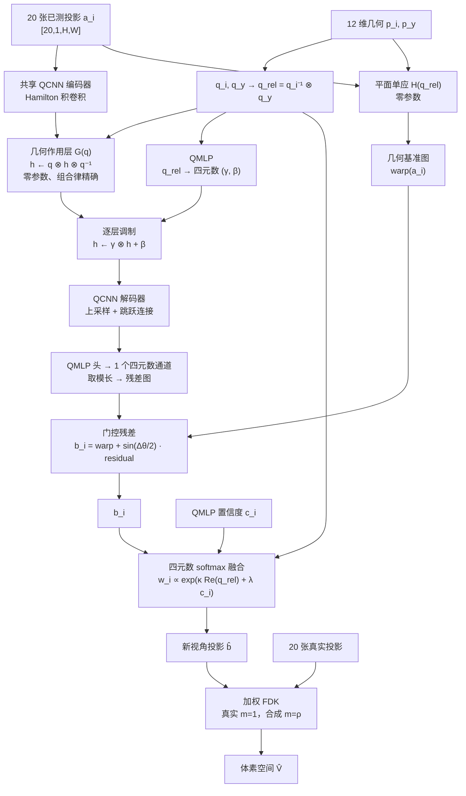

# 四元数新视角投影合成（Quaternion View Synthesis）

用 **20 个已测视角**合成大量**新的指定角度投影**，再用加权 FDK 重建体素空间。

与 `submodel/quaternion_geometry/` 的两个方向不同，本子模型不是"给融合权重加几何条件"，
而是**直接生成新视角的投影图像**：

| 子模型 | 输出 | 四元数的作用 |
|---|---|---|
| `quaternion_geometry` 方向一 | 修正后的 12 维几何 | 有界 `Δq` 校准位姿 |
| `quaternion_geometry` 方向二 | 融合后的 latent | 相对四元数 → 视角权重偏置 |
| **本子模型** | **新角度的投影图像** | **Hamilton 积作用在特征上 + 四元数 softmax 融合** |

---

## 1. 问题定义

C 臂的射线源与平板探测器绕患者长轴旋转一周采集投影。给定

* 视角 $x$ 的 12 维几何 $\mathbf{p}_x$ 与其投影 $a$，
* 目标视角 $y$ 的几何 $\mathbf{p}_y$，

我们希望得到 $y$ 度下的投影 $b$。网络形式为

$$
b_i=\mathcal{F}_\theta\big(a_i,\;q_{i\to y}\big),\qquad
q_{i\to y}=q_i^{-1}\otimes q_y
$$

其中 $q_v=\mathrm{Quat}(R_v)$ 由该视角的探测器基向量构造。**输入不是 4 维实数向量，
而是四元数本身**；网络内部所有层都是四元数算子。

对 20 个已测视角各调用一次，得到 $\{b_1,\dots,b_{20}\}$，再用四元数 softmax 融合：

$$
\hat b=\sum_{i=1}^{20} w_i b_i,\qquad
w_i=\mathrm{softmax}_i\Big(\kappa\,\mathrm{Re}(q_{i\to y})+\lambda\,c_i\Big)
$$

最后把 20 张真实投影与 $N$ 张合成投影一起送入 FDK。

> **必须明确的定位**：合成视角是那 20 个测量的函数，不引入新信息。它把角度采样从
> $18°$ 加密到 $1°$ 量级，能显著抑制 FDK 的角向混叠条纹，但分辨率和噪声仍由 20 个
> 真实测量决定。实验必须给出 `FDK-20`（下界）、`FDK-fused`、`FDK-dense`（同数量
> **真实**视角，信息上界）三条曲线，否则无法归因。

---

## 2. 几何基础

### 2.1 坐标与旋转轴

`transforms.json` 的每一帧是

```text
vec = [source(3), detector(3), u_vector(3), v_vector(3)]
```

`u_vector` / `v_vector` **已经把像素间距折进去了**（`models/render.py:angle2vec`）。

本仓库的 `angle2vec` 令 `cam_x ∝ cosα`、`cam_y ∝ sinα`、`cam_z` 恒定，即主旋转绕 **z 轴**；
而在 CT 坐标里 z 正是头→脚的患者长轴，与需求描述的"绕 y 轴"是同一件事，只是命名不同。
因此**不需要对已有 `transforms.json` / `proj.nii.gz` 做任何坐标重排**。

对理想圆弧轨道：探测器 $v$ 轴（竖直）始终平行于旋转轴，$u$ 与法向 $\hat{\mathbf{n}}$ 在
横断面内旋转。于是相对旋转 $\mathbf{R}_s^\top\mathbf{R}_t$ 是一次**绕相机 $v$ 轴**转
$\Delta\theta$ 的旋转，对应四元数

$$
q_{s\to t}=\cos\frac{\Delta\theta}{2}+\sin\frac{\Delta\theta}{2}\,\mathbf{j}
$$

若做 twist–swing 分解 $q=q^{\parallel}\otimes q^{\perp}$，则 $q^{\parallel}$ 是绕 $v$ 的
twist，而 **$q^{\perp}$ 在理想圆轨道上恒为单位四元数**——它只在 C 臂摆动、$\beta$ 倾斜、
探测器安装误差出现时才非平凡。这一点必须写清楚：离面视差来自**源的平移**，不是来自
相机之间的相对旋转。

### 2.2 平面诱导单应（零参数几何路径）

记 $\mathbf{R}_{rel}=\mathbf{R}_t^\top\mathbf{R}_s$、$\mathbf{t}_{rel}=\mathbf{R}_t^\top(\mathbf{C}_s-\mathbf{C}_t)$，
等中心所在平面在源相机系里是 $z=d$（$d=\mathrm{SAD}$）：

$$
H=K_t\Big(\mathbf{R}_{rel}+\frac{\mathbf{t}_{rel}\mathbf{e}_z^\top}{d}\Big)K_s^{-1},
\qquad
K=\begin{bmatrix} \mathrm{SID}/du & 0 & (W-1)/2\\ 0 & \mathrm{SID}/dv & (H-1)/2\\ 0&0&1\end{bmatrix}
$$

焦距必须用 $\mathrm{SID}/du$（像素单位），不能用 $1/du$——这是实现里最容易错的一步。

冒烟测试实测：把 $0°$ 视角 warp 到 $1°$，与真实 $1°$ 投影的相关系数 **0.9999**、MAE **0.0029**
（投影均值 0.30），说明几何路径正确。

---

## 3. 网络结构

**只有四元数算子**（QConv / QLinear / QNorm）+ 一条**零参数**几何路径。`grid_sample`
是几何算子，不是可学习层，因此不违背"只含 QCNN + QMLP"的约束。



### 3.1 QCNN 定义

特征图 `[B, 4C, H, W]`，通道按 `4c+k` 存放四元数 $(a,b,c,d)$。四元数核的乘法等价于
4×4 Hamilton 矩阵

$$
H(a,b,c,d)=\begin{bmatrix} a&-b&-c&-d\\ b&a&-d&c\\ c&d&a&-b\\ d&-c&b&a\end{bmatrix}
$$

因此一个 QConv 是**一次** `conv2d`（核由上式拼装），参数量恰好是"4 倍通道实值卷积"的
**1/4**：

```text
QConv(8→8, 3×3)      = 2400 参数（含 bias）
Conv2d(32→32, 3×3)   = 9248 参数
```

配套件全部走四元数：单位四元数权重约束、split-ReLU、`QNorm`（每个四元数通道一组）、
`QLinear` 组成的 QMLP。

### 3.2 几何作用层

$$
\mathcal{G}(q):\quad h\;\longmapsto\;q\,h\,q^{-1}
$$

只作用在四元数特征的虚部 3-向量上（即自然 $SO(3)$ 作用）。该层**零参数**，且精确满足

$$
\mathcal{G}(q_2)\circ\mathcal{G}(q_1)=\mathcal{G}(q_2\otimes q_1)
$$

冒烟测试实测组合误差 **4.8e-7**。这就是"从 X 转到 Y、再从 Y 转到 Z"与"直接 X 转到 Z"
在代数上自动一致的来源；实值 FiLM / 拼接做不到这一点，这是使用四元数的**唯一硬理由**。

**不要声称整个网络对 C 臂旋转等变**：QConv 的权重并不与 $q$ 交换，等变性不成立。成立
的只有上面这条组合律。四元数网络的可测收益是"参数 1/4 + 受代数约束的跨分量耦合"，
不是等变性。

### 3.3 锚点约束

$$
b_i=\mathcal{W}\big(a_i;H\big)+g\,\Delta\mathcal{F}_\theta\big(a_i,q_{i\to y}\big),
\qquad g=\sin\frac{\Delta\theta_i}{2}
$$

$g(q=\mathbf 1)=0$，所以当目标角度恰好等于输入角度时网络输出**严格等于原图**，20 个真实
测量不会被改写。冒烟测试实测 `max|out - a| = 2.5e-6`。

---

## 4. 四元数 softmax

权重必须是实数（要做凸组合），但 logit 来自四元数代数：

* $\mathrm{Re}(q_{i\to y})=\cos(\Delta\theta_i/2)$：与单位元的四元数内积，即"离目标角度多近"；
* $c_i$：QCNN 从全局池化四元数特征经 QMLP 输出的置信度；
* $\kappa,\lambda$ 可学习。

可选的一致性旋转（真正的四元数聚合）：

$$
\bar q=\arg\min_{q\in S^3}\sum_i w_i\big\|\log(\bar q^{-1}q_{i\to y})\big\|^2
$$

即 $SO(3)$ 上的加权 Fréchet 均值；若 $\bar q\ne q_y$，说明网络认为 20 个视角的几何仍有
残余偏差，可再对 $\hat b$ 做一次单应纠正。

**必看的诊断图**：$w_i$ 对 $\Delta\theta_i$ 的曲线。如果它只是单调衰减，说明 $c_i$ 没学到
东西，几何核已经解释了一切，QCNN 就是多余的前处理。

---

## 5. 损失

$$
\mathcal{L}=\underbrace{\|\hat b-b_y^{gt}\|_1}_{\text{融合监督}}
+\lambda_v\underbrace{\frac{1}{20}\sum_i\|b_i-b_y^{gt}\|_1}_{\text{逐视角监督}}
+\lambda_{en}\underbrace{\Big[\alpha\,\overline{|r|}+(1-\alpha)\,\overline{r^2}\Big]}_{\text{残差 Elastic Net}}
$$

其中 $r$ 是网络输出的残差图（`output["residual"]`），$\alpha$ = `--elastic_l1_ratio`
默认 0.5，$\lambda_{en}$ = `--lambda_elastic_net` 默认 `1e-2`。

**为什么把 Elastic Net 加在残差上，而不是加在权重上**：模型是残差式的
$b=\mathcal{W}(a;H)+g\,r$，而单应 warp 本身就有 ~35 dB。所以网络改动的每一块像素都必须
由数据证明其必要性：

* L1 部分 → 稀疏：绝大多数像素保持 warp 结果，只修正遮挡进出与锥束视差；
* L2 部分 → 收缩：禁止出现局部大块"幻觉"。

这正好对应本任务的归纳偏置。权重域的 Elastic Net 也实现了
（`--lambda_elastic_weight`，默认 0 = 关闭），作为对照消融。

无 GT 时的自监督项（可用于真实数据，**当前代码尚未实现**）：

$$
\mathcal{L}_{agree}=\frac{1}{20}\sum_i\big\|b_i-\hat b\big\|_2^2
$$

> 组合一致性 $\mathcal{F}(\mathcal{F}(a,q_1),q_2)\approx\mathcal{F}(a,q_2\otimes q_1)$ 已由
> $\mathcal{G}(q)$ 在结构上保证，不需要额外损失项去"学"，只作为评估指标使用。

---

## 6. 加权 FDK

$$
f(\mathbf{x})=\sum_v \Delta\beta\; m_v\;\Big(\frac{\mathrm{SID}}{U_v}\Big)^{2}
\big[\,p_v\cdot\tfrac{\mathrm{SID}}{\sqrt{\mathrm{SID}^2+u^2+v^2}}\;*\;h_{ramp}\big](u_v,v_v)
$$

* 真实视角 $m_v=1$，合成视角 $m_v=\rho$（默认 0.25）；
* 等权 FDK 会把 20 个相关测量插值出的"假测量"当成数百个独立测量，产生比稀疏条纹更难
  清理的结构伪影；
* FDK 的绝对灰度取决于斜坡滤波与 $\Delta\beta$ 的离散化，评估时对每个重建做一次最小二乘
  灰度标定（`fdk.fit_scale`），并在 `metrics.json` 里记录标定系数。

实测参考（dental `X2313838`，32³，桶检测器 128²）：360 真实视角 corr **0.978** /
PSNR **29.5 dB**；20 真实视角 corr **0.921** / PSNR **24.1 dB**。

---

## 7. 文件

| 文件 | 职责 |
|---|---|
| `geometry.py` | 12 向量 → 相机系、相对运动、平面单应、可微 warp、残差门控 |
| `qconv.py` | Hamilton 积、`QConv2d`、`QLinear`、`QNorm`、`QBlock`、几何作用层 `rotate_feature_vector` |
| `model.py` | `QuaternionViewSynthesizer`（$b=\mathcal F(a,q)$）、`QuaternionSoftmaxEnsemble` |
| `dataset.py` | dental 投影读取 + 降采样缓存（`.npy` memmap）、视角索引选择 |
| `fdk.py` | 余弦加权 → 斜坡滤波 → 加权反投影、灰度标定、PSNR |
| `metrics.py` | 投影域 PSNR / SSIM / L1（Torch 实现，可直接在 GPU 上批量算） |
| `losses.py` | 残差 / 参数的 Elastic Net 正则 |
| `smoke_test.py` | 五条自检：单应正确性、锚点恒等、组合律、参数比、FDK 合理性 |
| `train.py` | 训练 |
| `evaluate.py` | 测试 / 评估 + 可视化 |
| `infer.py` | 推理：20 → 全部剩余视角 → 加权 FDK → 保存 `.nii.gz` |
| `warp_baseline.py` | S0 基线：零参数单应 warp（nearest / mean20 / median20） |

数据根目录：`dataset/dental/syn_data/<病例>/{proj.nii.gz, transforms.json, gt_volume.nii.gz}`，
划分为 `data/dataset_split/dental_split.json`（train 99 / val 10 / test 20）。
降采样缓存在 `dataset/dental/_nvs_cache/`。

---

## 8. 命令

以下命令均在仓库根目录执行，环境为 conda `deeplearning`。

### 8.1 冒烟测试（自检，秒级）

```bash
conda run -n deeplearning python -m submodel.quaternion_view_synthesis.smoke_test
```

期望输出（已实测）：

```text
[smoke] homography 0->1 : corr=0.9999 mae=0.0029 (mean intensity 0.3008)
[smoke] identity gate=0.000000 max|out-a|=2.503395e-06
[smoke] composition law max error=4.768e-07
[smoke] params QConv(8->8,3x3)=2400 vs real conv(32->32)=9248
[smoke] fdk finite=True corr=0.9211 psnr=24.09dB
[smoke] OK
```

### 8.2 训练冒烟（2 例、1 epoch）

```bash
conda run -n deeplearning python -m submodel.quaternion_view_synthesis.train --smoke --name qvs_smoke
```

会同时打分 train/val/test 三个 split（各 2 例 × 2 个目标角）并写 TensorBoard。
`--smoke` 会强制 `--eval_every 1 --save_every 1`，这样 1 个 epoch 也能看到指标变化和
`ckpt_history/` 的生成。实测输出（`--lambda_elastic_net 1e-2`，即默认值）：

```text
[qvs] subjects=2 parameters=0.838M device=cuda
[qvs] tensorboard -> .../checkpoints/qvs_smoke_en/tensorboard
[qvs] scoring splits ['train', 'val', 'test'] every 1 epoch(s), 2 subject(s) x 2 target(s) each
[qvs] epoch   0 train psnr=18.7782 ssim=0.1476 l1=0.2222 (n=4)
[qvs] epoch   0 val   psnr=18.7409 ssim=0.1543 l1=0.2323 (n=4)
[qvs] epoch   0 test  psnr=18.7876 ssim=0.1402 l1=0.2202 (n=4)
[qvs] epoch 0 step 1 ... loss=0.2477 elastic=0.25628 residual_mean=0.3511
[qvs] epoch 0 step 2 ... loss=0.1070 elastic=0.21834 residual_mean=0.2947
[qvs] epoch 0 done mean_fused_l1=0.17731 ... elapsed=0.7s
[qvs] epoch   1 train psnr=35.3563 ssim=0.8693 l1=0.0251 (n=4)
[qvs] epoch   1 val   psnr=35.4800 ssim=0.8787 l1=0.0257 (n=4)
[qvs] epoch   1 test  psnr=34.5696 ssim=0.8559 l1=0.0261 (n=4)
```

注意 `--smoke` 下 `epoch 0` 只有 **2 个优化步**（2 例 × 1 目标），所以 `epoch 1` 那一行
就是训练 2 步后的结果。

`step 0` 是随机初始化（残差是噪声，指标很差）；2 步后跳到 ~35 dB，说明网络迅速把随机
残差压小。Elastic Net 让 `residual_mean` 从 0.351 降到 0.295，方向与"压小残差"一致，
因此 2 步内指标略优于无正则版本（train 35.31→35.36，test 34.53→34.57）。

**参照值不是 35 dB，而是下面 S0 实测的 ~33.5–34 dB**（见 8.9）。也就是说 2 步之后的
模型已经略微超过"只用一个最近视角做 warp"，但还远没有证明它学会了合成。

### 8.3 评估冒烟（1 例 + 可视化）

```bash
conda run -n deeplearning python -m submodel.quaternion_view_synthesis.evaluate ^
  --ckpt submodel/quaternion_view_synthesis/checkpoints/qvs_smoke/ckpt_latest.pt ^
  --split test --limit 1 --n_synth 40 --fdk_res 64 --visualize --run_name qvs_smoke
```

PowerShell 中续行用反引号 `` ` ``，或直接写成一行。

### 8.4 正式训练

```bash
python -m submodel.quaternion_view_synthesis.train ^
  --name qvs_dental --image_size 256 --epochs 40 --n_views 20 ^
  --n_targets 4 --base_channels 24 --levels 2 --lr 2e-4 --lambda_per_view 0.1
```

常用参数：

| 参数 | 默认 | 含义 |
|---|---|---|
| `--n_views` | 20 | 输入的已测视角数（每 18°） |
| `--n_targets` | 2 | 每个病例每个 epoch 随机采样的目标角度数 |
| `--target_stride` | 10 | 目标角度网格（度） |
| `--base_channels` | 16 | 四元数通道数，实际特征通道为 4× |
| `--lambda_per_view` | 0.1 | 逐视角监督权重 |
| `--angle_scale` | 4.0 | 四元数 softmax 的 κ 初值 |
| `--lambda_elastic_net` | 1e-2 | 残差 Elastic Net 权重（0 关闭） |
| `--elastic_l1_ratio` | 0.5 | 1 = 纯 L1(LASSO)，0 = 纯 L2(ridge) |
| `--lambda_elastic_weight` | 0.0 | 参数量 Elastic Net（权重衰减），默认关闭 |

输出：`submodel/quaternion_view_synthesis/checkpoints/<name>/ckpt_latest.pt`

#### 训练期指标与 TensorBoard

每 `--eval_every` 个 epoch（**默认 5**）在 **train / val / test** 三个 split 上计算
**投影域** PSNR / SSIM / L1，并写入 TensorBoard：

```bash
tensorboard --logdir submodel/quaternion_view_synthesis/checkpoints/<name>/tensorboard
```

| 参数 | 默认 | 含义 |
|---|---|---|
| `--eval_every` | 5 | 每 N 个 epoch 算一次指标；0 表示关闭 |
| `--eval_limit` | 4 | 每个 split 用于估指标的病例数 |
| `--eval_targets` | 4 | 每个病例固定使用的目标角度数 |
| `--eval_splits` | `train,val,test` | 要打分的 split 列表 |
| `--tensorboard_dir` | `<out>/<name>/tensorboard` | 事件目录 |
| `--no_tensorboard` | — | 只打印不写事件文件 |

指标是**确定性**的：病例取 split 的前 `eval_limit` 个，目标角度在候选集上等间隔取
`eval_targets` 个，所以不同 epoch 的曲线可直接比较。训练开始前会先记录一次
`step=0` 的初始值。

记录到 TensorBoard 的标量：

```text
train/loss_fused      train/loss_view      train/loss_total       (每步)
train/loss_elastic    train/residual_mean                          (每步)
train/mean_fused_l1_per_epoch
train/kappa           train/lambda          (四元数 softmax 的两个可学习参数)
train/{psnr,ssim,l1}  val/{psnr,ssim,l1}  test/{psnr,ssim,l1}    (每 eval_every)
```

注意：这里的 PSNR/SSIM 是**合成投影与真值投影**之间的指标（投影域），不是重建体数据
与 GT 体积之间的指标。体积域指标请用 `evaluate.py` / `infer.py`。

#### 权重保存

| 文件 | 频率 | 说明 |
|---|---|---|
| `ckpt_latest.pt` | **每个 epoch** | 总是被覆盖，用于续跑/最新状态 |
| `ckpt_history/ckpt_XXXX.pt` | 每 `--save_every` 个 epoch（**默认 5**） | 零填充编号（`ckpt_0005.pt`、`ckpt_0010.pt`…），用于回滚与选模型 |

checkpoint 内容：`model`、`ensemble`、**`optimizer`**、`args`、`epoch`、`steps_total`、
`loss`、`rng_state`、`numpy_rng_state`。因为保存了 Adam 的一二阶矩和 RNG 状态，可以真正
中断续训：

```bash
python -m submodel.quaternion_view_synthesis.train ^
  --name qvs_dental ^
  --resume submodel/quaternion_view_synthesis/checkpoints/qvs_dental/ckpt_history/ckpt_0020.pt ^
  --epochs 40
```

注意：

* `--epochs` 是**总** epoch 数，不是"再训多少"；从 20 续训到 40 就传 `--epochs 40`。
* 续训时请传与原来相同的 `--name`，否则会写到新目录（脚本会打印提示）。
* 续训不会再记录一次 `step=0` 的指标；指标按 `(epoch+1) % eval_every` 继续。
* 旧 checkpoint（没有 `optimizer` 字段）仍可加载，脚本会提示 Adam 动量重置。

实测（`--limit 1 --epochs 6 --n_targets 1`，同一随机种子）：

| epoch | 一口气训 6 epoch | 训 3 epoch → `--resume` → 再训到 6 |
|---|---|---|
| 3 | 0.01661 | **0.01663** |
| 4 | 0.01324 | **0.01325** |
| 5 | 0.02524 | **0.02527** |

差异在 1e-5 量级（cuDNN 非确定性），说明优化器状态与数据采样顺序都被正确恢复。

实测（`--epochs 6`，默认 `--eval_every 5 --save_every 5`）：

```text
[qvs] scoring splits ['train', 'val', 'test'] every 5 epoch(s), 4 subject(s) x 4 target(s) each
[qvs] epoch   0 ... psnr/ssim 记录一次（初始权重）
[qvs] epoch 1..4 ... 只训练，不算指标
[qvs] saved snapshot .../ckpt_history/ckpt_0005.pt
[qvs] epoch   5 ... psnr/ssim 再记录一次
```

### 8.5 测试（仅指标，test split）

```bash
python -m submodel.quaternion_view_synthesis.evaluate ^
  --ckpt submodel/quaternion_view_synthesis/checkpoints/qvs_dental/ckpt_latest.pt ^
  --split test --n_synth 80 --fdk_res 128 --run_name qvs_dental
```

输出 `submodel/quaternion_view_synthesis/eval/qvs_dental/metrics.json`：

```json
{
  "X2313838": {
    "fdk_20":    {"psnr": 24.49, "rmse": 0.00508, "scale": 1.0},
    "fdk_fused": {"psnr": 25.21, "rmse": 0.00467, "scale": 1.0},
    "fdk_dense": {"psnr": 27.55, "rmse": 0.00357, "scale": 1.0},
    "max_source_angle_deg": 180.0
  },
  "summary": {
    "fdk_20":    {"psnr": 24.49, "rmse": 0.00508},
    "fdk_fused": {"psnr": 25.21, "rmse": 0.00467},
    "fdk_dense": {"psnr": 27.55, "rmse": 0.00357}
  }
}
```

（以上为**未训练**网络的冒烟实测值，只用于确认管线通路，不能作为方法效果。）

### 8.6 评估（指标 + 可视化）

```bash
python -m submodel.quaternion_view_synthesis.evaluate ^
  --ckpt submodel/quaternion_view_synthesis/checkpoints/qvs_dental/ckpt_latest.pt ^
  --split test --n_synth 80 --fdk_res 128 --visualize --run_name qvs_dental
```

每个病例输出两张图：

* `<病例>_projections.png`：3 行 × 4 列，分别是**已测视角**、**合成视角**、**同角度真值**；
* `<病例>_volumes.png`：3 行（轴位/冠状/矢状）× 4 列，分别是 `GT`、`FDK-20`、
  `FDK-fused`、`FDK-dense`。

### 8.7 推理（20 → 340 → FDK → 保存体数据）

```bash
python -m submodel.quaternion_view_synthesis.infer ^
  --ckpt submodel/quaternion_view_synthesis/checkpoints/qvs_dental/ckpt_latest.pt ^
  --split test --n_synth 0 --fdk_res 128 --save_png --run_name qvs_dental
```

流程与输出：

```text
20 个已测视角（0,18,...,342）
    ↓ 逐目标角度调用合成器 + 四元数 softmax
                340 个剩余视角（--n_synth 0 表示全部）
    ↓ 拼成 360 视角
加权 FDK（真实 m=1，合成 m=--synth_weight）
    ↓
<out_dir>/<run_name>_<split>/
    <病例>_fdk_fused.nii.gz   20 真实 + N 合成
    <病例>_fdk_20.nii.gz      只用 20 真实（基线）
    <病例>_slices.png         轴向/冠状/矢状对比图（--save_png）
    <病例>_synthetic_views.nii.gz   合成投影栈（--save_projections）
    metrics.json
```

要点：

* `--n_synth 0` 才是"生成全部 340 个"；给具体数字（如 40 / 80）则只补前 N 个。
* FDK 的逐视角权重要**归一化到均值 1**（`fdk.reconstruct(..., normalize_weights=True)`），
  否则灰度会随视角数变化，20 视角和 360 视角的重建无法直接比较。归一化后
  `X2313838_fdk_fused.nii.gz` 的值域实测约 `[-0.015, 0.087]`，与 GT 的 μ 量级
  （`0 ~ 0.0901`）一致，可直接放进 ITK-SNAP / 3D Slicer 查看。
* `--synth_weight` 控制合成视角的**相对可信度**。默认 0.25 时，340 个合成视角的
  总权重（85）是 20 个真实视角（20）的 4 倍，未训练的模型会产生明显的**同心环伪影**
  ——这是"合成视角彼此高度相关又被大量复制"的典型症状，正式实验要么先训练，
  要么把 ρ 降到 0.05 以下。

### 8.8 用哪个 split

| split | 例数 | 用途 |
|---|---|---|
| `train` | 99 | 训练 |
| `val` | 10 | **目前没被任何脚本使用**，应保留做模型选择 |
| `test` | 20 | **报数与推理默认用这个**（`infer.py` / `evaluate.py` 默认 `--split test`） |
| `visual` | 2 | **是 test 的子集**（`X2313838`、`X2334763`），只用于出图，不能当独立验证集报数 |

结论：**推理用 `test`**。`visual` 与 `test` 有重叠，不能用来做无偏评估。

### 8.9 S0 基线：纯几何 warp（零参数）

```bash
python -m submodel.quaternion_view_synthesis.warp_baseline ^
  --splits train,val,test --limit 4 --eval_targets 4
```

它测的是 `b = warp(a) + g·residual` 里 **`residual ≡ 0`** 时的成绩，也就是学习部分必须
超越的下限。三种变体差异极大：

```text
--- train (4 subjects) ---        --- test (4 subjects) ---
  nearest   psnr=33.38 ssim=0.9569     nearest   psnr=33.98 ssim=0.9573
  mean20    psnr=19.29 ssim=0.8610     mean20    psnr=19.92 ssim=0.8645
  median20  psnr=17.89 ssim=0.8155     median20  psnr=18.70 ssim=0.8197
```

| 变体 | 含义 |
|---|---|
| `nearest` | 只取角度最接近目标的那个已测视角，做一次单应 warp。20 视角每 18° 一个，所以最近距离恒 ≤ 9°。 |
| `mean20` | 20 个 warp 结果等权平均（"朴素融合"） |
| `median20` | 20 个 warp 的逐像素中位数 |

**为什么 `mean20` 会崩到 19 dB**：单应只把**过等中心的那个平面**映射得准确；离该平面越远，
视差越大，而视差随 $|\Delta\theta|$ 增长。20 张 warp 里大部分来自角度差十几度甚至上百度的
视角，等权平均等于把 20 张错位的图叠在一起 → 严重模糊。PSNR 用真值自身的动态范围计算，
模糊直接表现为对比度损失，所以掉得很狠；SSIM 只掉到 0.86，是因为结构还在。

这条结论直接决定了网络该学什么：**不是"把 20 个 warp 平均"，而是"判断该信哪个视角 + 修正
离面视差"**。也说明四元数 softmax 的权重必须能随 $|\Delta\theta|$ 强烈衰减，否则一定会退化
成 `mean20`。

---

## 9. 消融阶梯

| 编号 | 增加什么 | 说明 |
|---|---|---|
| **S0** | 纯单应 warp（无网络） | 纯几何基线，先跑这个判断增益来源 |
| **S1** | warp + 实值 CNN 残差（参数与 S2 对齐） | 四元数是否真的有贡献的**唯一判据** |
| **S2** | 换 QCNN，去掉 $\mathcal{G}(q)$ 与 QMLP 调制 | 只保留 Hamilton 积卷积 |
| **S3** | + 几何作用层 $\mathcal{G}(q_{s\to t})$ | 组合律开始生效 |
| **S4** | + QMLP 输出四元数 $(\gamma,\beta)$ 调制 | 完整网络 |
| **S5** | 融合权重去掉 $c_i$（κ 固定），只留角度核 | 检验 QCNN 置信度是否有用 |
| **S6** | 输入视角数 1→2→4→20 | 量化集成收益，若 1→20 提升很小说明饱和 |
| **S7** | FDK 中 $\rho$ 扫描 0 / 0.1 / 0.25 / 0.5 / 1.0 | 合成视角的可信度权重 |

> S1 与 S2 **必须参数匹配**（实值通道数 = 4× 四元数通道数），否则无法归因。

---

## 10. 已知限制

1. **不增加信息**。合成视角是 20 个测量的函数，`fdk_dense` 才是信息上界。若 `fdk_fused`
   接近 `fdk_dense`，说明真正的增益来自"角向加密"这一几何事实，网络只是提供了插值。
2. **$q^{\perp}\approx\mathbf 1$**。理想圆弧轨道下相对旋转恒为绕探测器竖直轴，四元数分解
   没有"离面"分量；离面视差由源平移产生，靠单应 + 残差网络处理。只有真实 C 臂的摆动/
   几何误差才会让 $q^{\perp}$ 非平凡。
3. **无等变性**。QConv 权重与条件四元数不交换，只有 $\mathcal{G}$ 的组合律成立。
4. **角度泄漏**。输入视角集合在训练时应随机化，否则模型会记住固定 18° 网格。
5. **真实数据**。Walnuts / thorax 没有 360° 全角度 GT，只能用 $\mathcal{L}_{agree}$
   自监督；落地前需先核查其角向覆盖是否完整。
6. **分辨率**。冒烟测试在 128² 投影 / 32³~64³ 体素上跑通；正式实验需 512² 与 256³，
   显存与时间会显著上升（`--image_size`、`--fdk_res` 控制）。
